<div align="center">



<br/><br/>

<a href="https://42.fr"></a>&nbsp;<a href="https://hackthebox.com"></a>&nbsp;&nbsp;

<br/><br/>

&nbsp;

</div>

<br/>

<table align="center" border="0">
<tr>
<td width="55%" valign="middle">

</td>
<td width="45%" valign="middle">

### Hey, I'm Cornedru

Student at **École 42**, currently doing an internship in cybersecurity.

I like understanding what sits between a browser and a server: obfuscated JavaScript, small bytecode VMs, fingerprinting and challenge layers. I try to rebuild what I learn in **Rust** or **Go**, and I write notes as I go.

- 🔬 Learning reverse engineering on client-side web protections
- 🐛 Getting started with bug bounty
- 🦀 Rust & Go for side projects, C from 42
- 🧪 HackTheBox & CTFs to keep practicing
- 💼 Looking for an internship or junior role in **security / backend** from July 2027

> *Still learning: break it, understand it, write it down.*

</td>
</tr>
</table>

<br/>


## ⚡ Stack

<table align="center" border="0">
<tr>
<td align="center" width="33%">
<b>Languages</b><br/><br/>
<br/>

</td>
<td align="center" width="33%">
<b>Environment</b><br/><br/>

</td>
<td align="center" width="33%">
<b>Reverse & Security</b><br/><br/>


<br/>


</td>
</tr>
</table>

<br/>


## 🧭 What I work on

<table align="center" border="0">
<tr>
<td width="33%" valign="top">

### 🔬 Reverse engineering
**Client-side protections** · obfuscated JS, custom bytecode VMs, challenge-response flows<br/>
**Fingerprinting** · browser & TLS fingerprints, sensor data, device signals<br/>
**Native** · ELF analysis, Ghidra, GDB, protocol reconstruction

</td>
<td width="33%" valign="top">

### 🐛 Bug bounty
**Targets** · web platforms and the security layers in front of them<br/>
**Infra** · origin exposure behind CDN / WAF, misconfigurations<br/>
**Process** · PoC, clear write-up, responsible disclosure

</td>
<td width="33%" valign="top">

### 🦀 Systems & tooling
**Rust** · async services, multi-crate workspaces, protocol reimplementation<br/>
**Go** · HTTP stacks, browser-like transport, scrapers<br/>
**C** · 42 curriculum: shells, threads, raycasting, libc from scratch

</td>
</tr>
</table>

<br/>


## 📈 Activity



<br/>

<div align="center">



<br/>


<sub>Most of my work lives in private repositories: the public graph is only the tip of it.</sub>

</div>

<br/>


## 🗺️ Roadmap

```diff
  2026 → 2027
+ [done]  École 42 core curriculum
+ [done]  First security reports (responsible disclosure)
! [wip]   Understanding browser-side VMs & fingerprinting better
! [wip]   Rust tooling for protocol & protection analysis
- [next]  Public write-ups (HTB, reverse engineering notes)
- [next]  First junior role in security or backend
```

<br/>


## 📬 Contact

<div align="center">

<a href="https://github.com/Cornedru"></a>

<br/><br/>

<sub>Stay curious. Break things. Learn from them.</sub>

</div>
